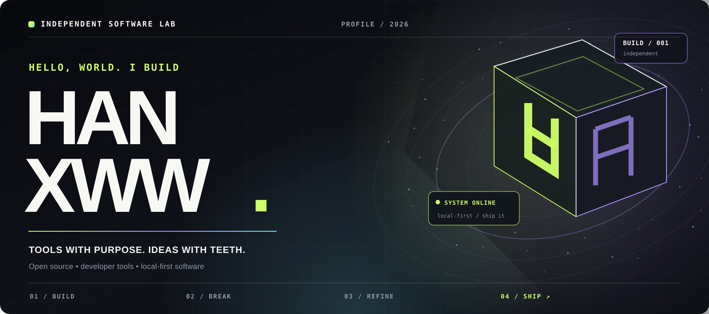
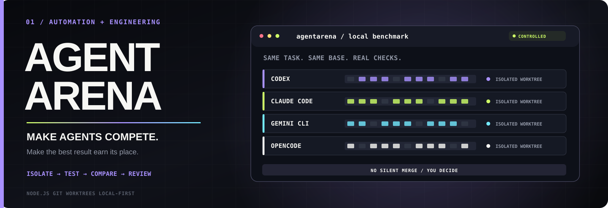
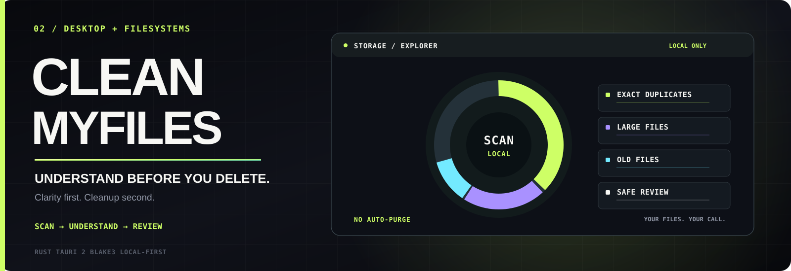
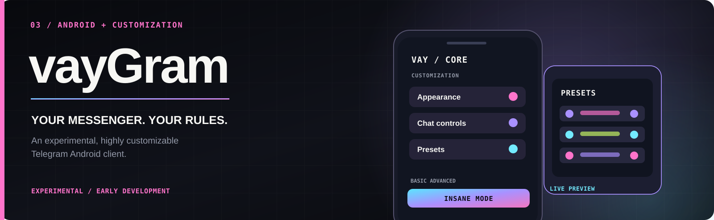
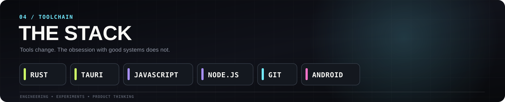
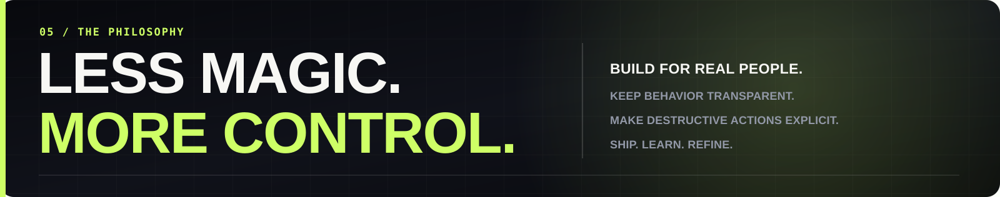
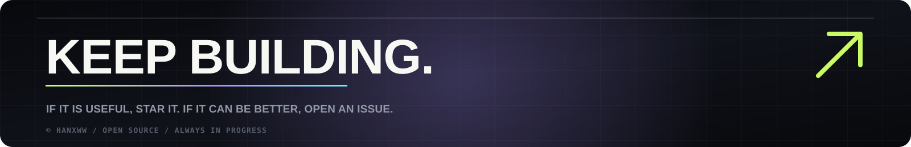

<!--
  HANXWW / THE INDEPENDENT SOFTWARE LAB
  Original GitHub profile design, 2026.
  All artwork is self-hosted in ./assets — no external image hosting required.
  To publish: put README.md and the assets/ folder inside the hanxww/hanxww repository.
-->

 

&nbsp;

&nbsp;

  

<b>ENGINEER. EXPERIMENT. REFINE. REPEAT.</b>

---

### `// TRANSMISSION 000 — WHO'S BEHIND THE CODE?`

I’m **hanxww** — an independent developer turning *“what if?”* into working software.

I build **developer tools**, **desktop utilities**, and **experiments in user control**. My favorite kind of software is powerful under the hood, calm on the surface, and honest about what it does.

> **The mission:** Less friction. Fewer mysteries. More agency for the person using the software.

 

<b>⚔️ 01 / AgentArena — see the engineering behind the arena</b>

 

**[Explore AgentArena →](https://github.com/hanxww/AgentArena)**

Run different coding agents on **the same engineering task**, from the **same base commit**, in **isolated Git worktrees**. Run real project checks, inspect diffs, compare results, and choose whether to apply the winner.

`Node.js` · `Git` · `Codex` · `Claude Code` · `Gemini CLI` · `OpenCode` · `Local-first`

**Why it matters:** Public benchmark scores can't tell you which agent is right for *your* repository. AgentArena lets your own checks help decide.

 

<b>🧹 02 / CleanMyFiles — understand first, clean second</b>

 

**[Explore CleanMyFiles →](https://github.com/hanxww/CleanMyFiles)**

A desktop file analyzer for examining disk usage, finding **exact duplicates**, and reviewing large or old files — **without automatic deletion**. Scans run locally, and the final choice always stays with you.

`Rust` · `Tauri 2` · `BLAKE3` · `Local-first` · `Review before action`

**Why it matters:** A cleanup app should make you confident, not make decisions about your files for you.

 

<b>🎛️ 03 / vayGram — customization without chaos</b>

 

**[Explore vayGram →](https://github.com/hanxww/vayGram)**

An **early-development** experiment exploring extreme customization for a Telegram Android client: settings scopes, visibility levels, presets, and a modular approach to UI changes.

`Android` · `VayCore` · `Customization` · `Experimental`

**Why it matters:** Customization should unlock possibilities without turning everyday use into a chore.

 

 

 

### `// SIGNAL — ACTIVITY IN THE OPEN`

 

&nbsp;

&nbsp;

 

<b>🇷🇺 На русском — немного обо мне</b>

 

Привет! Я **hanxww**. Создаю инструменты для разработчиков, десктопные приложения и экспериментальные проекты.

- **AgentArena:** сравнение AI-агентов на реальных задачах в твоём репозитории.
- **CleanMyFiles:** анализ занятого места и дубликатов файлов без автоматического удаления.
- **vayGram:** экспериментальный Android-клиент с глубокой кастомизацией.

Мне нравится софт, который даёт пользователю **контроль**, работает **предсказуемо** и не прячет важные решения за красивыми кнопками.

 

  
   
  Designed for the curious. Built in public.

